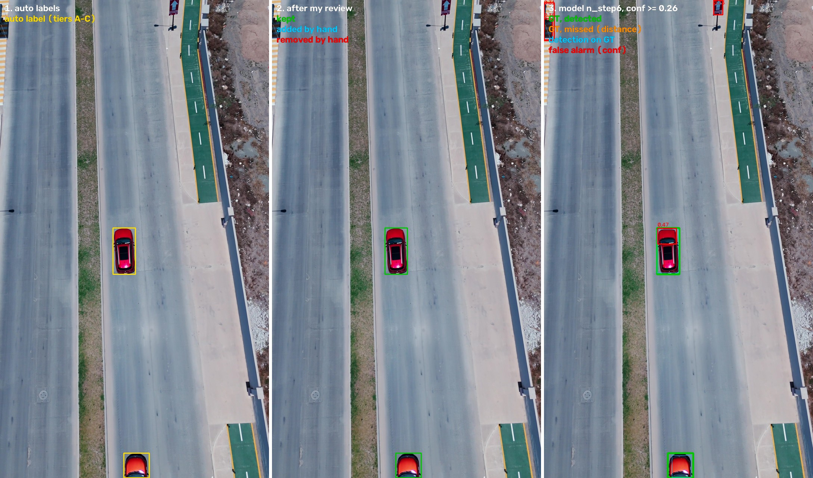
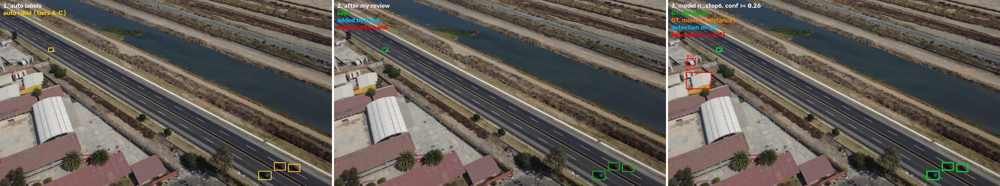
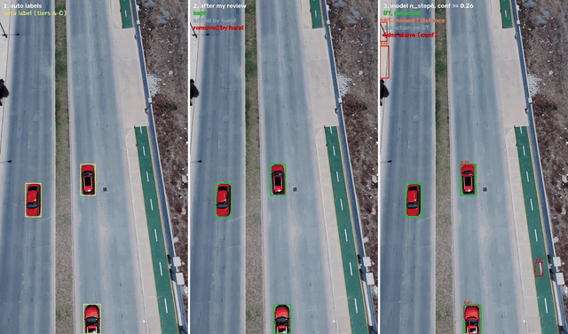

# Vehicle detection from drone video

Task: build a single-class `vehicle` detector for drone video and show how it performs at 0–200 m and 200–400 m.

## 0. Summary

There are no ready-made labels, so most of the work is an auto-labelling pipeline. The trained model is more of a check of what can be learned from these labels.

- **Auto-labelling.** Three detectors (YOLO26x, RT-DETR-x, Grounding DINO) run on native-resolution tiles, followed by voting, tracking and a per-track decision (section 4). On eval it reaches DR 0.95 / 0.81 and precision 0.99 / 0.86 at 0–200 / 200–400 m.
- **Manual review.** Eval only, in CVAT, track by track, under an hour. Of 275 auto-labelled tracks I kept 219 (80%) and added 28 vehicles by hand (section 6).
- **Model.** YOLO26n on 640 px tiles; the model and the threshold were chosen on val by F1 (sections 7, 8). Eval is the task clip plus 6 more Pexels clips: the task clip has no vehicles beyond 200 m (section 2). Nothing was tuned on eval:

| Metric | 0–200 m | 200–400 m |
|---|---|---|
| Detection rate | 0.80 | 0.50 |
| Precision | 0.60 | 0.41 |
| False alarms / min | 221 | 48 |
| Time to first detection, s | 0.21; never found 4% | 1.15; never found 32% |
| mAP@0.5 (bonus) | 0.71 | 0.36 |

- **Distance** comes from the box size: 82° field of view, 4.5 m car (section 3).
- **Conclusion.** The teacher is strong, the student is not. A small model trained for a few minutes on three clips transfers poorly to new scenes: it raises false alarms on houses, manholes and pedestrians and misses cars between houses (section 9). What to do about it is in section 10.

## 1. Repository map

The result is split into two parts:

| Part | Where | What's inside | Size |
|---|---|---|---|
| **1. Code and results** | this repository | pipeline code and config; metric tables, stats and logs of every stage; detections and tracks (`*.parquet`); images with labels; trained model weights; eval labels after my review; result videos: auto labels, eval labels, model, "three views" | ~0.6 GB |
| **2. Data and intermediate material** | archive `aerial-vehicle-detector-pipeline.tar` on [Google Drive](https://drive.google.com/open?id=163_on3Jn_WM82-ih17FeXchNMKZXFMMM) | source videos, frames, dataset tiles, CVAT tasks, videos of the intermediate stages 04 and 04c, a few videos over 50 MB, COCO model weights | ~22 GB |

The first part is enough to read the README, look at all tables, images and result videos, and take the weights. The second part is needed to re-run the pipeline or look at the intermediate stages. To get it:

1. Download the archive from [Google Drive](https://drive.google.com/open?id=163_on3Jn_WM82-ih17FeXchNMKZXFMMM) in a browser (~23 GB). For a file this big Google says it can't scan it for viruses — click "Download anyway".
2. Put `aerial-vehicle-detector-pipeline.tar` into the repository root.
3. Unpack it with the script in the repository root:

```bash
bash restore_data.sh                  # puts every file in place, leaves the files from git untouched
bash restore_data.sh --check-only     # how many files are still missing
bash restore_data.sh --delete-archive # the same, then deletes the archive
```

Before unpacking, the script checks that the archive is complete (its size), so a half-finished browser download is not unpacked. Files of the second part are marked ⬇ in this README, and the full list is in `data_manifest.txt`. All paths are relative to the repository root.

**What the task asked for and where it is:**

| What | Where |
|---|---|
| Pipeline | `pipeline/` (stages `s01`–`s09`), `run_all.sh`, config `configs/pipeline.yaml` |
| Metrics table | `outputs/09_eval/eval/table_n_step6.md`, in this README — section 9.2 |
| Model weights | `outputs/08_train/n_step6/weights/best.pt` (YOLO26n) |
| Video on the eval clip | `outputs/09_eval/eval/n_step6/viz/32179597_n_step6.mp4` (model and labels), `outputs/09_eval/eval/n_step6/viz/story_32179597.mp4` (auto labels → my review → model); all videos — section 11 |
| Example predictions with labels | `outputs/09_eval/eval/n_step6/viz/*.jpg`, two of them in section 9.3 |
| Auto labels | tracks with tiers for all clips: `outputs/05_triage/tracks.parquet`; per-clip videos: `outputs/05_triage/viz/<clip>.mp4`; train and val in YOLO format: `datasets/yolo/` ⬇ |
| Manual eval review | what went to CVAT: `outputs/05_triage/cvat/<clip>/annotations.xml` (task frames — `outputs/05_triage/cvat/<clip>.zip` ⬇, labels — `outputs/05_triage/cvat/labels.json`); my exports: `datasets/annotations/cvat_eval/`; eval labels after the review: `datasets/annotations/eval_gt.parquet` |

**Structure:**

```
configs/pipeline.yaml          all parameters; every number has a comment on where it came from
datasets/
  sources/{train,eval}/ ⬇      source videos from Pexels
  meta/clips.yaml              clip registry and camera assumptions (sections 2, 3)
  meta/frames.parquet          frame catalog (stage 01)
  frames/<clip>/ ⬇             JPEG frames at native resolution
  annotations/cvat_eval/       my CVAT exports
  annotations/eval_gt.parquet  eval labels on every frame (stage 06)
  yolo/ ⬇                      640 px tiles and labels for training (stage 07)
docs/story_32179597.gif        GIF preview for section 11 (cut from the story video with ffmpeg)
outputs/NN_<stage>/            one folder per stage: log, config snapshot, stats.json, tables, viz/
pipeline/                      sNN_*.py — stages; common.py, geometry.py, detectors.py, viz.py — shared code
scripts/fuse_ablation.py       NWD ablation in the fusion (4.3)
run_all.sh                     the whole pipeline in order
restore_data.sh                unpacks the archive: puts the files that are not in git in place
data_manifest.txt              the list of those files
yolo26n.pt; yolo26x.pt, rtdetr-x.pt ⬇   COCO weights; Ultralytics looks for them in the root and downloads them if missing
```

**How to run:**

```bash
pip install torch torchvision --index-url https://download.pytorch.org/whl/cu128   # match your CUDA
pip install -r requirements.txt
bash restore_data.sh       # after downloading the archive: the pipeline needs the source videos
bash run_all.sh
```

Grounding DINO is downloaded from Hugging Face on the first run. Stage 06 reads my exports from `datasets/annotations/cvat_eval/`, so the manual review doesn't have to be repeated. On an RTX 5090 the full run takes ~2 h, of which ~70 min go to the three auto-labelling detectors (stage 02). Each stage can be run on its own: `python -m pipeline.s03_fuse --config configs/pipeline.yaml`.

## 2. Data

All videos are from Pexels. The clip registry is `datasets/meta/clips.yaml`: role, scene, link, file and frame step. The videos are in `datasets/sources/`, the frames in `datasets/frames/`, and the frame catalog is `datasets/meta/frames.parquet`.

| Role | Clip | Scene | Video | Processed every N-th frame |
|---|---|---|---|---|
| train | 8968356 (A) | highway interchange | 1080p, 30 fps | 3 |
| val | 5382494 (B) | suburban road with houses, shot at an angle | 4K, 24 | 3 |
| train | 8457857 (C) | highway from above | 4K, 24 | 3 |
| train | 3405804 (D) | city intersection, lots of motorbikes | 4K, 30 | 3 |
| eval | 32179597 | task clip: city road, vertical video | 4K, 30 | 1 |
| eval | 19851623 | large highway and a parking lot | 4K, 25 | 3 |
| eval | 30404666 | highway by a canal, most of the far vehicles | 4K, 30 | 3 |
| eval | 30973709 | highway among trees | 4K, 60 | 6 |
| eval | 32814755 | forest road, two cars | 4K, 24 | 2 |
| eval | 13215276 | country road, one car and a cyclist | 4K, 60 | 6 |
| eval | 14313658 | fields and forest, no vehicles | 4K, 60 | 6 |

**Val is the whole clip B.** Neighbouring frames of one video are almost identical. If I had taken some frames of the train clips for val, the same cars would have ended up in both. So clip B, one of the four train clips of the task, went to val, and I trained on the other three.

**I extended eval to 7 clips.** After the review the task clip has no vehicles beyond 200 m, and the metrics are needed for both bands. So I added six:

- 30404666 and 19851623 — with far traffic;
- 14313658 — empty, false alarms show most clearly on it;
- a few sparse scenes to measure the time to first detection.

Eval was not used for training, thresholds or model selection.

**The auto-labelling models ran at ~10 frames/s** (every 2nd–6th frame, depending on fps). On every frame they would take 3–6 times longer, and neighbouring frames add almost nothing. The metrics, however, are computed on every frame: I interpolate the labels between the processed frames (section 6).

**Two more hard city clips** (dense city, 1080p) were planned as a stress test. But there wasn't enough time to review that much by hand, so I dropped them.

## 3. Distance

I don't know the flight altitude or the camera tilt, so I estimate the distance from the box size, as for a simple pinhole camera. Assumptions:

- 82° field of view along the long side of the frame, a typical DJI wide-angle lens. For the vertical task clip this is also the long side;
- average car length 4.5 m.

```
f_px = frame_long_side / (2 · tan(41°))      # 4K: ~2209 px
D    = f_px · 4.5 / box_long_side
```

| Video | car at 200 m | car at 400 m |
|---|---|---|
| 4K | ~50 px | ~25 px |
| 1080p | ~25 px | ~12 px |

The error is large, around ±25%: cars range from 3.5 to 5.5 m, plus perspective. A truck looks closer than it is, a small car looks farther. But the estimate is the same everywhere: in the auto-labelling, in the eval labels and in the metrics. So the bands are comparable with each other.

How a band enters the metrics:

- **a label box** — by its own size. The detection rate and the misses are counted from it;
- **a false alarm** — by the size of the detection itself;
- **a whole vehicle** (vehicles per band, time to first detection) — by the band where it first appeared.

Vehicles beyond 400 m (9 in eval) are not shown in the tables: the task asks only for 0–200 and 200–400 m.

## 4. Auto-labelling

There are no ready-made labels, and VisDrone, AU-AIR and UAVDT can't be used. So the models do the labelling and I only review it. Most of the time went here.

```
01 frames → 02 three detectors → 03 fusion (votes) → 03b zoom re-check → 04 tracks
        → 04b crop re-check → 04c analysis → 05 per-track decision → auto labels
```

Each stage is a separate module `pipeline/sNN_*.py`. It writes a config snapshot, a log, `stats.json` and visualizations (`viz/`) to `outputs/NN_*/`. All stages read one config, `configs/pipeline.yaml`, where every number has a comment on where it came from. The seed is 42 everywhere.

### 4.1 Frames (`outputs/01_frames`)

Each video is decoded once with ffmpeg into top-quality JPEGs at native resolution and orientation. A frame is uniquely identified by the pair `(clip_id, frame_idx)`, and its time is `frame_idx / fps`. For each clip, `outputs/01_frames/stats.json` has the resolution, fps, number of frames and the car size in pixels at 200 and 400 m.

### 4.2 Three detectors (`outputs/02_predict`)

YOLO26x, RT-DETR-x and Grounding DINO. The first two are trained on COCO, and I take the car, bus and truck classes from them. DINO gets the text prompt "car. truck. bus. van.". Each model alone makes a lot of mistakes, but the architectures differ, and so do their mistakes. That's why from here on I trust what at least two of them see.

- **Native-resolution tiles.** Each model runs on tiles of its own size (640, 640 and 800 px) with 20% overlap. Squeeze a 4K frame down to 640 px and a far car becomes 3–8 px, and nobody will see it.
- **Cut boxes are dropped.** A box touching an inner tile edge is a piece of a car that is fully visible in the neighbouring tile.
- **A separate full-frame pass** catches large near vehicles that don't fit in a tile.
- **The confidence threshold is low (0.05).** I filter later, when I know more. The raw detections are saved (`outputs/02_predict/<model>.parquet`), so the thresholds can be tuned without re-running the models.

What I checked once and how I decided:

- **DINO precision.** In bfloat16 it is ~30% faster, but I kept float32 as the reference.
- **"Decoys" for DINO.** I tried adding motorcycle, traffic cone, roof etc. to the prompt so it would stop calling them cars. Votes for far cars dropped threefold, so full frames get no decoys; they stayed only in the zoom re-check (4.4).

On eval each model alone finds 79–96% of the near vehicles with precision 0.93–0.94 (stages table, section 9).

### 4.3 Fusion: votes instead of confidence (`outputs/03_fuse`)

The three models have different confidence scales: 0.3 for DINO is not the same as 0.3 for YOLO. So I don't average the confidence, I count votes. A model "votes" for a box if its confidence is above its own threshold. I merge the boxes of the three models into clusters, and for each cluster I count k — how many models voted (1–3). A model contributes at most one box to a cluster, and the final box is the confidence-weighted mean of the cluster's boxes.

| Model | Vote threshold | How I chose it (one-off sweep over the saved detections) |
|---|---|---|
| YOLO26x | 0.15 | lowering it from 0.25 adds confirmations and almost no lone boxes |
| RT-DETR-x | 0.4 | raising it from 0.3 removes 22–33% of lone boxes at the cost of 8–11% of confirmed ones |
| Grounding DINO | 0.3 | |

- **How boxes are compared depends on the distance.** Near boxes (up to 200 m) are compared by IoU, far ones by NWD (normalized Wasserstein distance). The idea: on a 10–15 px box a two-pixel shift already lowers IoU noticeably, and different models draw the box of one car slightly differently. Then the votes of three models for one far car can fall apart into lone boxes and end up as junk. NWD is calmer about small shifts.
  The ablation showed that on this data NWD changes nothing (`outputs/03_fuse_iou_only/ablation.csv`, fusion with IoU for all pairs). Without NWD there are even 1–1.5% more confirmed boxes at 200–400 m, and the eval DR is the same (0.74). In 4K a car at 200–400 m is 25–50 px, and IoU still works for it. I kept NWD for smaller boxes (beyond 400 m, 1080p video), but didn't measure it there separately.
- **Group boxes.** A box with two other boxes inside it is flagged as a group box: that's how DINO outlines several cars at once, and a detector a whole truck over separate cab and trailer boxes.
- **Nested pieces.** A lone box (k=1) inside a confirmed one is dropped: most often it's a truck cab.

On eval the fusion of all boxes finds the most vehicles (DR 0.98 / 0.86), but it also has the most junk (precision 0.87 / 0.62). Voting "≥ 2 models" raises precision to 0.98 / 0.88, while DR drops to 0.91 / 0.74 (section 9).

### 4.4 Zoom re-check (`outputs/03b_zoom`)

Small doubtful boxes (k ≤ 2) are cropped together with their surroundings, upscaled so the long side becomes ~40 px, and shown to all three models again. The upscaling is at most 2.5×: I compared 2.5× and 4× once, and 2.5× confirmed more. Zoom creates no new boxes, it only adds votes.

- **A new vote only comes from a model that was silent before.** At first zoom "confirmed" itself: a model that had already voted voted again. And a model finding nothing on the crop doesn't prove anything either.
- **This is where DINO gets the decoys:** motorcycle, traffic cone, road barrier, traffic sign, roof, swimming pool. If it calls the crop a decoy, that's evidence against a vehicle.

19.5% of the boxes seen by one model and 13.6% of those seen by two got a vote. But to be honest, zoom barely changed the eval metrics (section 9). Its contribution goes on through the tracks.

### 4.5 Tracker (`outputs/04_track`)

A real car lives for many frames, while a false detection flickers. So from here on I decide per track, not per box.

ByteTrack didn't fit. Its second association step is hard-wired to IoU, and far cars need NWD. I also need to tell moving cars from static ones, and that requires camera motion compensation. So I used a simple tracker:

- **Camera motion compensation.** Before the association every track is moved into the coordinates of the current frame with a homography (ORB + RANSAC on the frame downscaled to 960 px; moving cars are just outliers for it). Then "static" means static on the ground, not in the frame. If the motion estimate fails, the last successful one is used. `outputs/04_track/stats.json` shows that this was never needed on any clip.
- **Association.** Hungarian algorithm; near cars by IoU ≥ 0.1, far ones by NWD ≥ 0.2. The thresholds are looser than in the fusion, because a car moves between frames.
- **Gaps** of up to 3 frames are filled with linear interpolation.

Each track gets a flag:

- **moving / static** — own speed (camera motion removed) above or below 0.5 car lengths per second;
- **short** — under 0.5 s;
- **flicker** — short, and every box of it was seen by one model only.

Train, val and eval gave 3,890 tracks. In `outputs/04_track/viz/<clip>.mp4` ⬇ the box colour shows the track flag.

### 4.6 Crop re-check: two-wheelers and rotation (`outputs/04b_recheck`)

We asked the models only for car, bus and truck, so a motorbike had nowhere to go but "car". So each track is shown to YOLO and RT-DETR once more: three crops with context (3× the box size), now with the bicycle and motorcycle classes.

- **Two-wheelers.** If a track comes out as a motorcycle or a bicycle in half of the checks or more, it's a two-wheeler and is removed. I looked through 40 such tracks by hand, and all 40 really were two-wheelers. There are 387 such tracks in total, 352 of them at the city intersection (3405804).
- **Rescue.** If a track has a low score but the crops confidently say "car", that's evidence in its favour (tier C, 4.8).

Along the way I also showed the crops rotated by 90° and found something interesting: COCO models are used to horizontal cars.

| Moving tracks, < 32 px | no rotation | 90° rotation |
|---|---|---|
| horizontal | 0.74 | 0.10 |
| vertical | 0.30 | 0.52 |

YOLO sees only 10% of small vertical cars, RT-DETR 83%. I didn't add rotation to the detection itself: it helps only small vertical cars and also "finds" road barrels and swimming pools. It's better solved in training (section 7). Crop examples: `outputs/04b_recheck/viz/two_wheelers.jpg`, `outputs/04b_recheck/viz/rescued.jpg`, `outputs/04b_recheck/viz/rejected.jpg`, `outputs/04b_recheck/viz/rotation.jpg`.

### 4.7 What tells a car from junk (`outputs/04c_analysis`)

This is where I got stuck the longest. Most tracks are junk: roofs, road markings, solar panels, signs. For each track I computed features (all of them are in `outputs/04c_analysis/tracks.csv`) and looked at the crops grouped by each feature: `outputs/04c_analysis/viz/by_score.jpg`, `outputs/04c_analysis/viz/by_size.jpg`, `outputs/04c_analysis/viz/by_jitter.jpg`. The selection rules (4.8) rely on two of them.

**Track score.** For each box it's the mean confidence of the three models (a model that didn't vote gives 0), and for a track it's the median over its boxes. 98% of the flicker tracks have a score < 0.18, i.e. lower than when two models agree. Among the tracks with a score ≥ 0.34, 10 out of 10 on the crops were cars.

**Size relative to nearby cars.** It's the ratio of the box size √(width · height) to the size a car should have at that spot in the frame: 1.0 means "like the nearby cars". The ruler is "anchors" — boxes that are almost certainly cars:

- same clip, ±1 s;
- the track moves on the ground;
- lives ≥ 0.5 s;
- seen by ≥ 2 models;
- not a group box.

On the anchors I fit the formula `log(size) = a + b·x + c·y` (x, y — the box centre in the frame). It gives the expected size at any point of the frame, taking perspective into account. The ratio of a track is the median over its boxes. With fewer than 6 anchors I take their median size; with no anchors at all, the size isn't checked.

Example: anchors at the top of the frame ~15 px, in the middle ~30 px, at the bottom ~60 px.

| Track | Where in the frame | Size | Expected | Ratio |
|---|---|---|---|---|
| panel on a roof | top | 8 px | 18.5 px | 0.43, too small |
| motorbike | bottom | 30 px | 61.9 px | 0.48, too small |
| car | middle | 30 px | 28.1 px | 1.07, ok |
| house roof | middle | 90 px | 28.1 px | 3.2, too big |

Boxes more than twice the expected size were always junk on the crops: houses, roofs, billboards (20 out of 20). The rules got the bounds 0.68–2.5.

**What didn't work, although it looked logical:**

- **Box stability and shape.** I thought a junk box jumps around. In fact the main junk stands still (something on a roof, a sign), and the detector puts a steady box on it every time. Zero jitter only means "the object is static", not "it's a car".
- **A learned filter — a one-off check, it didn't go into the pipeline.** I labelled 300 "grey" tracks blind and trained a classifier on ~30 features. On familiar clips it worked well (AUC 0.86), on a new clip worse (0.72): it memorizes the junk of specific clips. One rule survived from that labelling: tracks smaller than 0.68 of the expected size were junk or two-wheelers in 66 out of 72 cases. So I raised the lower size bound from 0.25 to 0.68.

**Whether to drop DINO — a one-off check.** It produces the most junk, so I compared the models:

| | YOLO26x | RT-DETR-x | DINO |
|---|---|---|---|
| tracks seen only by this model | 702 | 926 | 1201 |
| share of the confirmed moving-car boxes it voted for | 0.73 | 0.85 | 0.90 |
| confirmed moving cars up to 400 m that would lose their confirmation without it | 61 | 107 | 113 |

DINO is both the noisiest and the most sensitive. But its noise is lone, and the "≥ 2 models" rule removes it anyway. So I kept it.

### 4.8 Per-track decision (`outputs/05_triage`)

Each track gets a tier. The rules are checked in order, and the first one that matches wins. The decision is made for the whole track: either all its boxes become labels, or all of them disappear.

| Tier | Rule | Action |
|---|---|---|
| two-wheeler | the crops say "motorcycle / bicycle" in ≥ half of the checks (4.6) | remove |
| A | score ≥ 0.34, any size (trucks really are big) | keep |
| B | score ≥ 0.18 and size 0.68–2.5 of the expected | keep |
| C | size 0.68–2.5, and the crops say "car" in ≥ 2/3 of the checks with mean confidence ≥ 0.3 | keep |
| suspect | everything else | remove |

Where the thresholds come from:

- **0.34** — from this score on, 10 out of 10 crops are cars;
- **0.18** — roughly "two models agree";
- **size bounds** — from 4.7;
- **tier C** rescues small and vertical cars that COCO models see poorly (4.6).

| Example track | score | size | Tier |
|---|---|---|---|
| car on the road | 0.52 | 1.0 | A, keep |
| far car, seen by two models | 0.22 | 0.9 | B, keep |
| solar panel that fooled two models | 0.21 | 0.44 | too small for B, the crops don't say "car" → suspect |

**Quality.** I estimate that ~90–95% of the kept boxes are cars. The estimate comes from two sources:

- during the manual review I kept 94% of the tier A tracks on eval;
- in a blind sample ~82% of the tier B and C boxes were cars.

The price: ~200 real cars ended up among the suspect tracks, mostly short fragments (in the blind sample ~8% of the suspect tracks were cars).

**Where the result goes:**

- **train and val** go to training with tiers A–C as they are (section 7);
- **eval** is exported to CVAT for manual review (section 6):
  - `outputs/05_triage/cvat/<clip>.zip` — task frames;
  - `outputs/05_triage/cvat/<clip>/annotations.xml` — pre-labels;
  - `outputs/05_triage/cvat/labels.json` — labels for CVAT.

Per-clip videos: `outputs/05_triage/viz/<clip>.mp4`. The kept tracks are drawn over the removed ones: A green, B yellow, C cyan; suspect thin red, two-wheelers magenta.

## 5. Auto-labelling result

| Clip | Role | Frames processed | Tracks | A | B | C | Removed: suspect | Removed: two-wheelers | Boxes kept |
|---|---|---|---|---|---|---|---|---|---|
| 8968356 | train | 192 | 399 | 130 | 61 | 11 | 197 | 0 | 7,255 of 8,554 |
| 8457857 | train | 135 | 276 | 99 | 35 | 19 | 123 | 0 | 4,140 of 4,715 |
| 3405804 | train | 245 | 1,313 | 58 | 51 | 31 | 821 | 352 | 7,705 of 18,352 |
| 5382494 | val | 250 | 563 | 46 | 34 | 18 | 460 | 5 | 3,407 of 5,758 |
| 32179597 | eval | 918 | 155 | 13 | 9 | 3 | 128 | 2 | 2,619 of 3,356 |
| 19851623 | eval | 178 | 379 | 60 | 58 | 13 | 245 | 3 | 11,573 of 13,877 |
| 30404666 | eval | 326 | 745 | 41 | 49 | 13 | 620 | 22 | 4,169 of 6,950 |
| 30973709 | eval | 67 | 32 | 9 | 0 | 1 | 20 | 2 | 201 of 377 |
| 32814755 | eval | 224 | 21 | 4 | 1 | 0 | 16 | 0 | 89 of 164 |
| 13215276 | eval | 228 | 7 | 1 | 0 | 0 | 5 | 1 | 114 of 123 |
| 14313658 | eval | 297 | 0 | 0 | 0 | 0 | 0 | 0 | — |
| **Total** | | | **3,890** | **461** | **298** | **109** | **2,635** | **387** | **41,272 of 62,226** |

868 of the 3,890 tracks (22%) and two thirds of the boxes were kept. The junk is mostly short fragments. The hardest clips:

- **city intersection 3405804** — 821 junk tracks and 352 two-wheelers;
- **highway by the canal 30404666** — 103 of 745 tracks kept.

Not a single track appeared in the empty clip 14313658, and there really are no vehicles there.

## 6. Manual eval review (CVAT) and ground truth (`outputs/06_import`)

I reviewed only eval by hand, because the metrics are computed on it. Train and val go to training with the auto labels as they are: the task allows light manual cleanup, and I estimated the noise level of the auto labels above (4.8).

**How I reviewed.** Each eval clip is a separate "CVAT for video" task with tracks. One deletion removes a wrong track from all frames at once. The task shows all three classes: `vehicle` with a tier attribute A / B / C, plus `suspect` and `two_wheeler`, which the automation removed. Where needed, I changed the class of a track or added a missed car as a new track. Sometimes I fixed the box geometry when it clearly didn't match the car. The tier attribute stays on every box, so after the export you can see exactly what I changed. The whole review took under an hour; I did it while the models were training.

**How much of the auto labels I kept:**

| Tier | Tracks before | Kept | Share |
|---|---|---|---|
| A | 128 | 120 | 94% |
| B | 117 | 76 | 65% |
| C | 30 | 23 | 77% |
| added by me | — | 28 | — |

The hardest clip is the highway by the canal (30404666): there I kept only 39% of the tier B tracks.

**Import.** The CVAT exports are in `datasets/annotations/cvat_eval/labels.zip`. For each task the latest export is used, and `outputs/06_import/exports.csv` shows which ones. In CVAT I saw duplicates: two boxes on one car, a cab inside a truck box. Deleting them by hand takes long, so I added rules to s06 that remove them automatically. There turned out to be 187 of them:

| Type | Rule | Count |
|---|---|---|
| two boxes on one car | IoU > 0.5 | 137 |
| cab inside a truck box | ≥ 80% of the box inside another one | 20 |
| box over a group of parked cars | contains ≥ 2 other boxes | 30 |

Of two boxes I keep not the bigger one but the more stable track: first a track I drew by hand, then the longer one. A real car is visible for many frames, while a fragment flickers. Fragments of one car are merged into one `vehicle_id`, so that it counts once in the metrics. Examples of removed duplicates: `outputs/06_import/viz/dropped.jpg`.

**Interpolation to every frame.** The labels exist on every 2nd–6th frame, while the metrics are computed on every frame. So between neighbouring labelled frames of one car the box is interpolated linearly. Nothing is added before the first appearance, after the last one or across longer gaps. The 18,977 reviewed boxes became 52,284 on all frames.

**Result** (`datasets/annotations/eval_gt.parquet`):

| | 0–200 m | 200–400 m | > 400 m | Total |
|---|---|---|---|---|
| from the auto labels | 120 | 26 | 9 | 155 |
| added by me | 20 | 8 | 0 | 28 |
| all vehicles | 140 | 34 | 9 | 183 |

The band of a vehicle here is the one where it first appeared. By boxes, 90% came from the auto labels and 10% are mine. Videos with the final labels: `outputs/06_import/viz/<clip>_gt.mp4` (green from the auto labels, cyan added by hand, thin red — removed duplicates).

**Second check.** When the model gave many false alarms on eval, I went through all eval videos with labels and detections once more to check whether any cars were missing from the labels. The vast majority of the false alarms are model errors (section 9).

## 7. Dataset and training (`outputs/07_dataset`, `outputs/08_train`)

**Dataset** (`datasets/yolo/`). 640 px tiles at native resolution, cut the same way as in the auto-labelling and the evaluation. The model sees cars of the same size as at test time.

- **Labels** — tier A–C tracks without duplicates. Two-wheelers and suspect tracks stay background.
- **Tiles** — all tiles with cars plus 15% of the empty ones as background examples (roofs, fields, road markings). Which empty tiles are kept is decided by a hash of the tile name, so the dataset is the same every time. A box cut by the tile border is kept if ≥ 40% of it is inside the tile.
- **Rotation cycle.** COCO models see vertical cars poorly (4.6), so I rotate the train frames in a cycle: the first frame of the list 0°, the second 90°, the third 180°, the fourth 270°, the fifth 0° again. There are no copies: each orientation gets a quarter of the frames, and near-identical neighbouring frames look different. At first I made a rotated copy of every tile, but that just doubled the data. Val is not rotated.

Tile examples with labels: `outputs/07_dataset/viz/tiles.jpg`.

**Training.** YOLO26n with COCO weights; I took n so that training would be fast. I compare how densely to sample the frames: every 3rd, 6th or 9th. The epochs are 20, 40 and 60 respectively, so all runs make the same number of training steps. Otherwise the sparser variant would lose just because it trained less.

Augmentations:

- flips along both axes, since from above any orientation is normal;
- mosaic.

There is no arbitrary rotation: it inflates rectangular boxes. Ultralytics picks the best weights by the tiles of the val clip.

| Run | Every N-th frame | Epochs | Train tiles | Minutes | mAP50 on val tiles | mAP50-95 |
|---|---|---|---|---|---|---|
| n_step3 | 3 | 20 | 8,181 | 5.2 | 0.13 | 0.10 |
| n_step6 | 6 | 40 | 4,097 | 6.1 | 0.24 | 0.15 |
| n_step9 | 9 | 60 | 2,731 | 7.0 | 0.16 | 0.11 |

Where things are:

- `outputs/08_train/<run>/weights/best.pt` — weights;
- `outputs/08_train/<run>/results.csv` and the TensorBoard logs in the same folder — training curves;
- `outputs/08_train/runs.csv` — summary table.

All three models are weak on the val tiles. I look into why in section 8.

## 8. Model selection on val (`outputs/09_eval/val`)

I chose the model and the confidence threshold on val only. Eval took no part in the selection.

**The criterion is F1 at the operating point, not mAP.** All four task metrics (detection rate, precision, false alarms/min, time to first detection) depend on the confidence threshold. mAP averages over all thresholds, including those the model will never run at. So for each model:

1. I pick the threshold with the highest F1. F1 is computed separately for 0–200 and 200–400 m and averaged, so that the near cars, which are the majority, don't hide the far ones;
2. I compare the models by this best F1. Each model has its own threshold, because their confidence scales differ;
3. if two models differ by less than 0.01, the F1 at 200–400 m decides.

F1 weighs misses and false alarms equally. The task doesn't say which of them matters more, and of the four metrics two are about misses and two about false alarms. I report mAP as a bonus.

| Run | Threshold | F1 0–200 | F1 200–400 | F1 mean |
|---|---|---|---|---|
| n_step3 | 0.11 | 0.21 | 0.25 | 0.23 |
| **n_step6** ← selected | 0.26 | 0.30 | 0.49 | **0.39** |
| n_step9 | 0.05 | 0.17 | 0.33 | 0.25 |

The selection result: `outputs/09_eval/val/selected.json`. The val labels are auto labels without manual review, and they leave a lot to be desired: there is both junk and missed cars. They are good enough for comparing the runs with each other, because all runs are scored on the same labels. The real numbers come from eval.

**Why everything looks so bad on val (a one-off analysis).** mAP on val is 0.20, on eval 0.65. I checked three explanations:

1. **A bug in the evaluation?** No. During training Ultralytics computed mAP on the tiles of the same val clip, and it is just as low (0.13–0.24). Two independent estimates agree.
2. **The val labels?** They aren't perfect, but they aren't the main reason. On the crops of the cars the model never found (`outputs/09_eval/val/n_step6/viz/labels_by_hit_n_step6.jpg`), 40 out of 72, most are real cars: parked near houses and very far away on the road (11 of the 40 are beyond 400 m). There is little junk there.
3. **The model doesn't transfer to this scene?** Yes, that's the main one. The most confident false alarms (`outputs/09_eval/val/n_step6/viz/false_alarms_n_step6.jpg`) are buildings: sheds and small white houses, houses with gable roofs, narrow windows of a brick church, with confidence 0.76–0.86. The model learned that "a light box = a car". Val is shot at an angle over a suburb with houses, while train is an interchange, a highway from above and an intersection, where there are almost no houses seen at that angle.

Video with labels and detections: `outputs/09_eval/val/n_step6/viz/5382494_n_step6.mp4`.

## 9. Model on eval (`outputs/09_eval/eval`)

### 9.1 How I compute it

- **Inference** is the same as in the auto-labelling: 640 px tiles at native resolution, 20% overlap, a full-frame pass, NMS. The model runs on every frame.
- **The confidence threshold of 0.26 is taken from val.** I ran eval once, without tuning anything on it.
- **Matching** is greedy, starting from the most confident detection. The rule is the same as in the auto-labelling: up to 200 m IoU ≥ 0.3, beyond that NWD ≥ 0.5. It differs from plain IoU 0.3 by at most 1.5 pp. mAP@0.5 is computed the standard way, with IoU 0.5.

```
Detection rate = TP / (TP + FN)
  TP — a label box matched by a model detection on the same frame
  FN — a label box that no detection was matched to
  counted over all frames: a car visible for 100 frames and found on 74 gives 74 TP and 26 FN;
  a box goes into a band by its own distance

Precision = TP / (TP + FP)
  FP — a detection matched to no label box (its band is taken from its own size)

False alarms / min = FP × 60 / N_frames
  the task's formula, i.e. false alarms per 60 frames; per minute of video there are fps times more (24–60)

Time to first detection = first frame where the model found the car − first frame of the car in the labels, s
  mean and p90 over the found cars + the share of cars that were never found
```

### 9.2 Result

**Model n_step6** (6,424 frames, 7 clips; vehicles / boxes: 0–200 m — 140 / 44,705, 200–400 m — 34 / 7,051):

| Metric | 0–200 m | 200–400 m |
|---|---|---|
| Detection rate <sub>TP / (TP + FN)</sub> | 0.80 | 0.50 |
| Precision <sub>TP / (TP + FP)</sub> | 0.60 | 0.41 |
| False alarms / min <sub>FP × 60 / N_frames</sub> | 221 | 48 |
| Time to first detection, s <sub>mean; p90; never</sub> | 0.21; 0.08; never 4% | 1.15; 0.55; never 32% |
| mAP@0.5 (bonus) | 0.71 | 0.36 |

p90 is lower than the mean: the model finds 90% of the cars almost immediately and a few only after several seconds, and those few pull the mean up.

**For comparison — the auto labels (the teacher)**, the same metrics on the same labels:

| Metric | 0–200 m | 200–400 m |
|---|---|---|
| Detection rate | 0.95 | 0.81 |
| Precision | 0.99 | 0.86 |
| False alarms / min | 3.5 | 8.4 |
| Time to first detection, s | 0.06; 0.00; never 8% | 0.33; 0.02; never 12% |
| mAP@0.5 | 0.94 | 0.80 |

The teacher has a slight edge: I made the eval labels by reviewing exactly its boxes.

### 9.3 Eval through three views

Left — the auto labels, middle — the same after my review (green kept, cyan added, red removed), right — the model (green found, orange missed, red — a false alarm with its confidence; "F" — a detection from the full-frame pass).



**Task clip (32179597), frame 765.** The auto-labelling found the passenger cars on its own but missed the truck entering the frame from below, so I added it. The model finds the passenger cars but misses the truck. Its false alarms are on pedestrians with umbrellas, drain grates, manholes and a flower bed, and on two cars it adds an extra box on a part of the car.



**Highway by the canal (30404666), frame 162.** This is where I edited the auto labels the most: in the village on the left I removed some boxes and added others. The model sees the cars on the highway but misses almost all the ones parked between houses (orange) and gives false alarms on roofs.

Full video: `outputs/09_eval/eval/n_step6/viz/story_32179597.mp4` (the same for every eval clip: `outputs/09_eval/eval/n_step6/viz/story_<clip>.mp4`); the model on every eval clip: `outputs/09_eval/eval/n_step6/viz/<clip>_n_step6.mp4`.

### 9.4 Auto-labelling stages vs the model (`outputs/09_eval/eval/table_stages.md`)

I score each auto-labelling stage as a separate "detector" against the eval labels. This shows what each step gave and how much of it the model learned.

| | DR 0–200 | DR 200–400 | P 0–200 | P 200–400 | FA/min 0–200 |
|---|---|---|---|---|---|
| YOLO26x alone | 0.79 | 0.70 | 0.94 | 0.80 | 21 |
| RT-DETR-x alone | 0.82 | 0.64 | 0.93 | 0.71 | 28 |
| Grounding DINO alone | 0.96 | 0.80 | 0.94 | 0.76 | 29 |
| fusion, all boxes | 0.98 | 0.86 | 0.87 | 0.62 | 63 |
| fusion, k ≥ 2 | 0.91 | 0.74 | 0.98 | 0.88 | 10 |
| + zoom | 0.91 | 0.74 | 0.98 | 0.87 | 10 |
| **+ tracks and tiers = auto labels** | **0.95** | **0.81** | **0.99** | **0.86** | **3.5** |
| model n_step6 | 0.80 | 0.50 | 0.60 | 0.41 | 221 |
| model n_step6 on the stage frames | 0.81 | 0.50 | 0.51 | 0.34 | 348 |

Stages 02–03b ran at ~10 frames/s and are scored on those frames; the auto labels and the model on every frame. The last row puts the model in the same conditions as the stages.

- **Fusion** finds almost everything, but it also has 2–3 times more junk than each model alone.
- **Voting** cuts the junk sixfold at the cost of some cars.
- **Tracks and tiers** bring back lost cars and cut the false alarms threefold more.
- **Zoom barely helped on eval.**
- **The strongest single model is DINO**, which supports the decision to keep it (4.7).

### 9.5 Where the model fails

The false alarms concentrate in two clips: the dense scene 19851623 (highway and parking lot) gives 55% of all of them, and the task clip 32179597 another 29%. The misses are on the far clip 30404666, where DR is only 0.38. Per-clip breakdown: `outputs/09_eval/eval/table_n_step6.md`.

What I see in the frames (9.3), the videos (`outputs/09_eval/eval/n_step6/viz/<clip>_n_step6.mp4`) and the crops of the labelled cars (`outputs/09_eval/eval/n_step6/viz/labels_by_hit_n_step6.jpg`):

- **false alarms:** at 0–200 m, 16% of them are duplicates or pieces of real cars (the box overlaps a labelled car but wasn't matched to it). The rest are in places without cars: pedestrians with umbrellas, drain grates, manholes and concrete slabs in the grass, building roofs;
- **misses:** of 183 vehicles the model never found 21. Mostly these are blurry cars between houses and in yards in 30404666, and far cars. Another 23 it finds on fewer than half of the frames, mostly dark parked cars standing right next to their neighbours in the parking lot of 19851623.

I re-checked the eval labels (section 6): the vast majority of the false alarms are model errors, not gaps in the labels.

### 9.6 Conclusion

**Measured:**

- the auto labels are strong on eval (DR 0.95 / 0.81, precision 0.99 / 0.86), and the model is noticeably weaker (0.80 / 0.50 and 0.60 / 0.41);
- 84% of the false alarms come from two clips (19851623 and 32179597), and the far clip 30404666 gives most of the misses;
- the threshold from val is 0.26, so the model is not very confident in general.

**My hypotheses (not tested):**

- the model is too small and trained too little (YOLO26n, 5–7 min, three train clips), so it transfers poorly to new scenes;
- the threshold was tuned on val, which is a different scene, so it isn't optimal on eval.

## 10. Limitations and next steps

### Limitations

- **The distance is an estimate, not a measurement.** I don't know the camera altitude and tilt, so the band comes from the box size (section 3), with an error around ±25%. A car near the 200 m boundary can land in the neighbouring band.
- **Few far vehicles.** Eval has only 34 vehicles at 200–400 m, so the metrics of this band are shaky: one car changes the "never found" share by ~3 pp.
- **Train and val are auto labels without manual review.** The model learns the teacher's noise along with everything else, and I select the model and the threshold on unreviewed labels (section 8).
- **64% of the eval boxes are interpolated.** Every 2nd–6th frame was reviewed by hand, and the box is linear in between (section 6). That's accurate for smooth motion; on a sharp turn the box can drift a little.
- **The duplicate rule in s06.** Of two nested boxes, the longer track stays. If a piece (a cab) lasted longer than the whole truck, the piece stays in the labels.
- **The eval labels were reviewed by one person** — me, in about an hour.
- **Narrow data:** daytime Pexels videos, a few scenes. How the system behaves at night, in rain or in fog is untested.

### Next steps

**Code**

- **Refactoring.** Right now it's an MVP: large modules (e.g. `pipeline/s09_evaluate.py`) should be split into smaller parts and covered with tests.

**Auto-labelling**

- **A few iterations of statistics on "what the system kept, what a human removed, and why".** The disagreements after the manual review show best which rules and thresholds to adjust.
- **A wider ensemble:** SAM 3 / SAM 2.1 and a simple classifier on target crops — as another vote and as a filter.
- **More precise per-model thresholds and extra classes that absorb the background** (roof, zebra crossing, panel), so that junk votes for its own class instead of "car".
- **Better SAHI tiles**, so that fewer low-detail objects get into training.
- **The trained model as a fourth vote**, once it gets stronger.

**Training**

- **More diverse data:** more scenes, angles and altitudes, including suburbs with houses like in val.
- **Hyperparameters and augmentations** — both built into Ultralytics and beyond.
- **A P2 head** for small far cars.
- **Deliberately train on the junk the auto-labelling found.** The tracks that stage 05 removed as junk (roofs, zebra crossings, panels) are exactly what confuses the models too. Confident junk (more than twice the expected size, two-wheelers, crops saying "not a car") should go into training as background examples. Doubtful tracks should be validated automatically (e.g. with a classifier on the crops), and as a last resort by a person: ~8% of them are real cars.

**Validation**

- **Own best-epoch selection** by F1 at 0–200 and 200–400 m instead of Ultralytics' `best.pt`.
- **Manual review of val**, so that model selection relies on clean labels.
- **More far vehicles** in val and eval.

## 11. Result videos

Each video shows an eval clip "through three views". Left — the auto labels, middle — the same after my review in CVAT (green kept, cyan added, red removed), right — model n_step6 (green found, orange missed, red — a false alarm with its confidence).



| Clip | Video |
|---|---|
| 32179597 — the task clip | [`story_32179597.mp4`](outputs/09_eval/eval/n_step6/viz/story_32179597.mp4) |
| 30404666 — highway by the canal, far vehicles | [`story_30404666.mp4`](outputs/09_eval/eval/n_step6/viz/story_30404666.mp4) |
| 19851623 — large highway and a parking lot | [`story_19851623.mp4`](outputs/09_eval/eval/n_step6/viz/story_19851623.mp4) |
| 30973709 — highway among trees | [`story_30973709.mp4`](outputs/09_eval/eval/n_step6/viz/story_30973709.mp4) |
| 32814755 — forest road | [`story_32814755.mp4`](outputs/09_eval/eval/n_step6/viz/story_32814755.mp4) |
| 13215276, 14313658 | `outputs/09_eval/eval/n_step6/viz/story_13215276.mp4`, `outputs/09_eval/eval/n_step6/viz/story_14313658.mp4` ⬇ (over 50 MB) |

The model alone on the task clip: [`32179597_n_step6.mp4`](outputs/09_eval/eval/n_step6/viz/32179597_n_step6.mp4).
